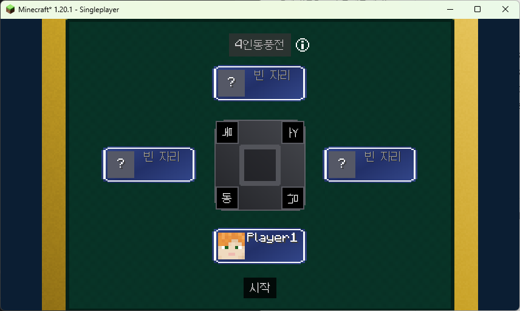
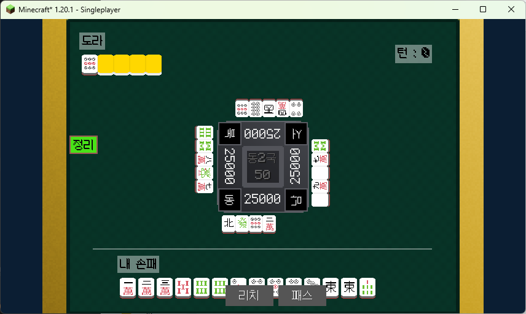
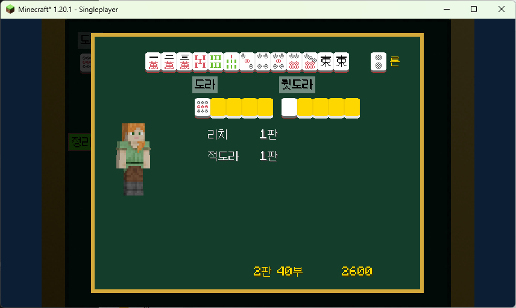
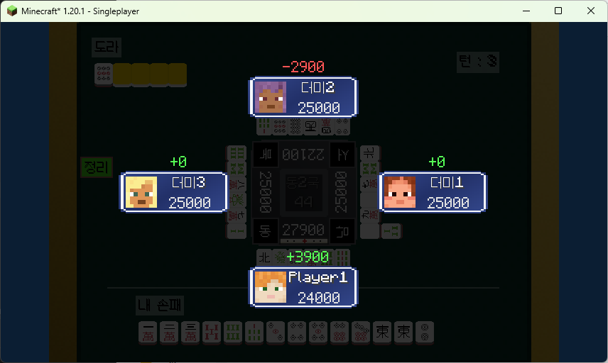
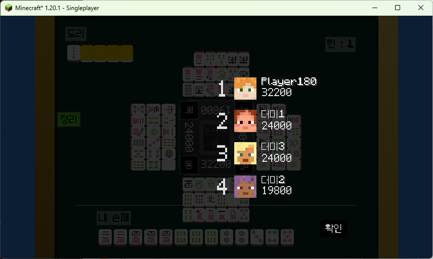

# Riichi Mahjong Mod

English | [한국어](README_ko.md)

A Fabric mod that brings Japanese Riichi Mahjong to Minecraft.

## Screenshots

### Match Setup Screen

### Gameplay

### Win Result

### Score Settlement

### Final Ranking

## Features

- Play RiichiMahjong inside Minecraft
- Dedicateed Mahjong table block and GUI
- Full yaku and score calculation system
- Dora, Riichi, Furiten, and Kan support
- Multiplayer support in development

## Implemented Features

### Game Rules

- Yaku detection system (including Yakuman and Counted Yakuman)
- Tsumo and Ron wins
- Riichi
- Chi, Pon, Daiminkan, Ankan, and Kakan
- Furiten support
- Dora system (Dora, Uradora, Kandora, Akadora)
- Fu and score calculation
- Point settlement
- Draw game processing
- Match end conditions
- Game state persistence using NBT

### GUI

- Themed green-and-gold interface
- Round information and score display
- Rotating discard pools
- Dora indicators
- Win result screen
- Score settlement screen
- Final ranking screen
- Match setup screen

### Multiplayer

- Multiple players can join the same table lobby
- Seat information synchronized between players
- Host-only game start controls

## Planned Features

### Multiplayer Expansion

- Full multiplayer gameplay
- Spectator mode
- Seat changing
- Additional multiplayer draw conditions

### Rules and Presentation

- Chankan support
- Improved draw result presentations
- Sideways Riichi discard display
- Called tile source indicators

### Polish

- UI improvements
- Rendering refactoring
- Texture scaling adjustments

## Installation

Currently under development.

Instructions will be added once a playable release is available.

## License

This template is available under the CC0 license. Feel free to learn from it and incorporate it in your own projects.
