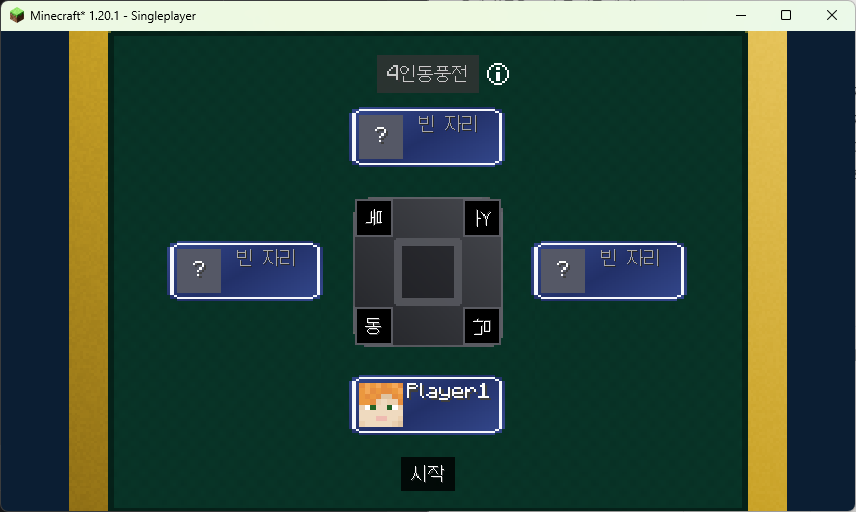
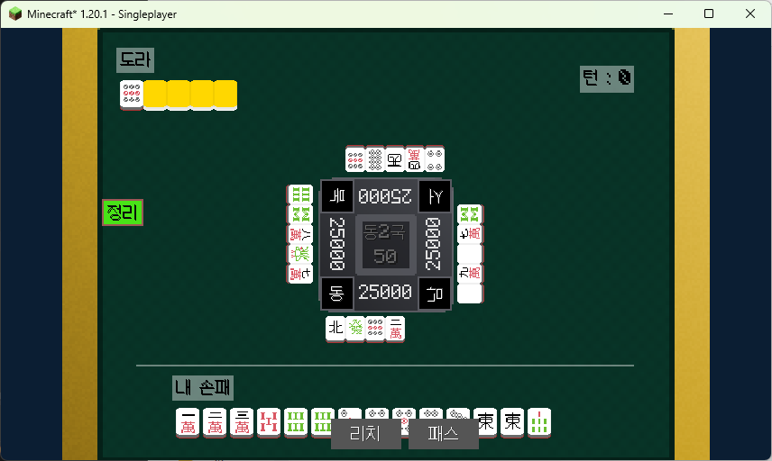
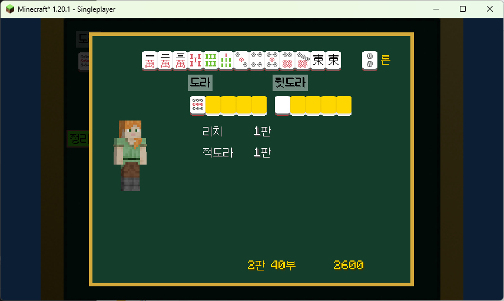
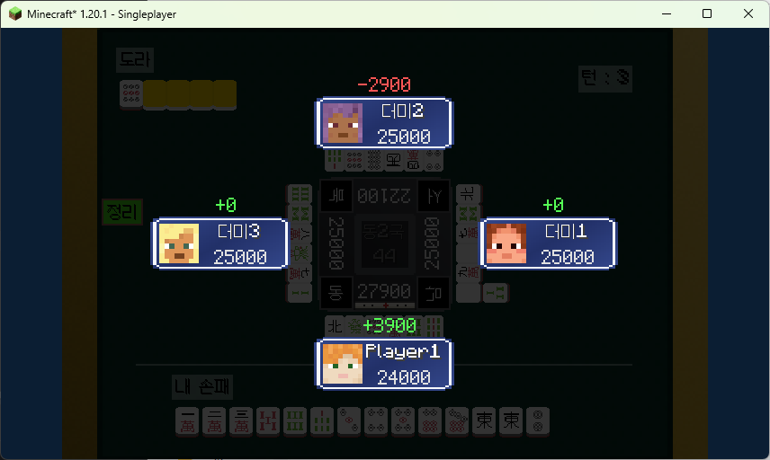
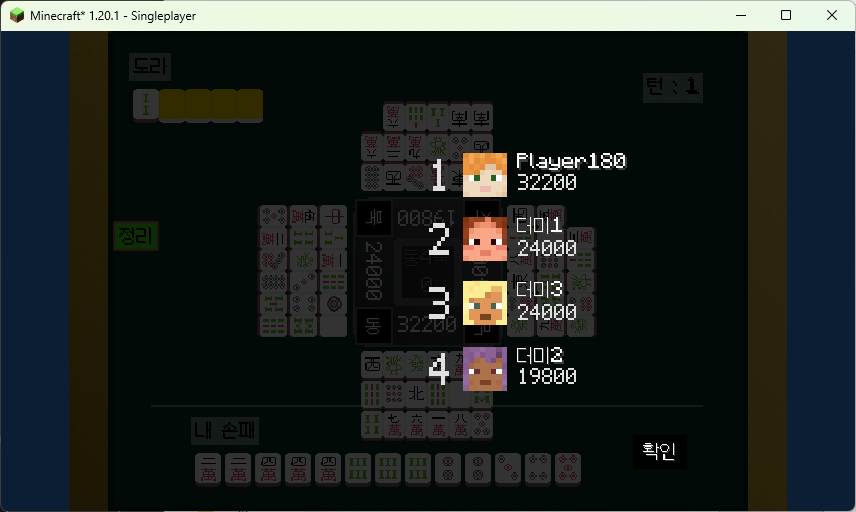

# Riichi Mahjong Mod

마인크래프트에서 일본식 리치마작을 플레이할 수 있도록 만드는 Fabric 모드입니다.

## 스크린샷

### 매치 준비 화면

### 게임플레이

### 화료 결과

### 점수 정산

### 최종 순위

## 주요 특징

- 마인크래프트 내 리치마작 플레이
- 전용 마작 탁자 블록 및 GUI
- 역 판정 및 점수 계산 시스템
- 도라, 리치, 후리텐, 깡 지원
- 멀티플레이 기능 개발 중

## 구현 완료 기능

### 게임 규칙

- 역 판정 시스템 (역만, 헤아림역만 포함)
- 쯔모 / 론 화료
- 리치
- 치 / 퐁 / 대명깡 / 안깡 / 가깡
- 후리텐 처리
- 도라 시스템 (표도라, 뒷도라, 깡도라, 적도라)
- 부수 및 점수 계산
- 점수 정산
- 유국 처리
- 대국 종료 판정
- NBT 기반 게임 상태 저장

### GUI

- 진녹색 + 금색 테마 UI
- 국 정보 및 점수 표시
- 회전형 버림패 표시
- 도라 표시
- 화료 결과 화면
- 점수 정산 화면
- 최종 순위표
- 대국 준비 화면

### 멀티플레이

- 다수 플레이어 입장 가능
- 좌석 정보 동기화
- 방장 전용 시작 버튼

## 개발 예정 기능

### 멀티플레이 확장

- 실제 다인 대국 진행
- 관전자 모드
- 좌석 변경
- 추가 유국 처리

### 규칙 및 연출

- 창깡 구현
- 유국 연출 개선
- 리치 선언패 눕혀 표시
- 부른패 출처 표시

### 다듬기

- UI 개선
- 렌더링 코드 정리
- 텍스처 비율 조정

## 설치 방법

현재 개발 중입니다.

플레이 가능한 버전이 공개되면 설치 방법을 추가할 예정입니다.

## 라이선스

이 템플릿은 CC0 라이선스로 공개되어 있습니다. 자유롭게 참고하고, 여러분 프로젝트에 가져다 써도 됩니다.